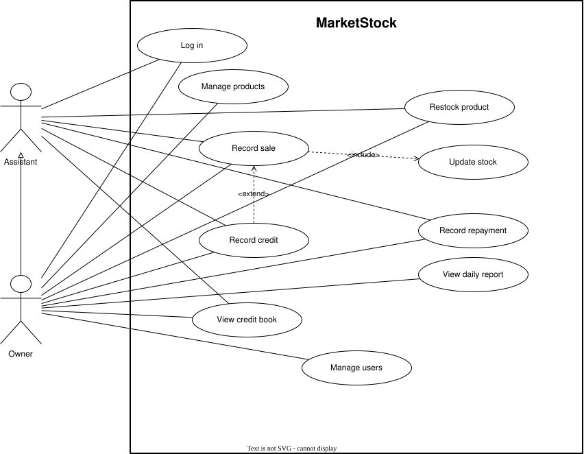

# MarketStock: Software Requirements Specification

## 1. Introduction

**Purpose.** This document defines what MarketStock must do. It is written for the developers, the testers, the course lecturer and the client (Mami Ngum).

**Scope.** MarketStock is a phone-browser web app for a small provision stall. It replaces the exercise book used today for products, stock, sales, credit customers and daily totals. It does not handle payments, suppliers' systems or accounting beyond daily sales and profit.

**Definitions.**

| Term | Meaning |
| --- | --- |
| Owner | The stall owner, with full rights |
| Assistant | A shop assistant who records sales and repayments |
| Low-stock level | The quantity at or below which a product is flagged for restock |
| Credit sale | A sale paid later; its total is added to the customer's balance |
| XAF | Central African CFA franc |

## 2. Overall description

**Stakeholders.**

| Stakeholder | Interest |
| --- | --- |
| Mami Ngum (owner) | Know her profit, catch low stock, collect debts |
| Divine (assistant) | Record sales quickly, and not be blamed for missing stock |
| Customers | Credit balances recorded correctly |
| Suppliers in Douala | (Indirect) more regular restock orders |
| Development group | Deliver by February with ten part-time members |

**Users.** The owner and the assistant use basic Android phones and are busy serving customers all day. They read French and English, and have little experience with apps.

**Operating environment.** A mobile phone browser (360 px wide) on a 3G connection.

**Constraints.** Amounts are shown in XAF with no decimals. The project is built with free tools by ten students, part-time, by February.

**Assumptions.** The stall has mobile data during opening hours. Each user has their own login.

## 3. Functional requirements

| ID | Requirement |
| --- | --- |
| FR-01 | The system shall let the owner add a product with name, unit, buying price, selling price, quantity and low-stock level. |
| FR-02 | The system shall let the owner edit a product's details and prices. |
| FR-03 | The system shall let the owner record a restock with product, supplier, quantity and buying price, and increase the stock by that quantity. |
| FR-04 | The system shall show the owner a list of products whose quantity is at or below their low-stock level. |
| FR-05 | The system shall let a user record a sale of one or more products, showing each line total and the sale total. |
| FR-06 | When a sale is confirmed, the system shall reduce the stock of each product sold and show a receipt. |
| FR-07 | The system shall reject a sale whose quantity is greater than the quantity in stock, and show the quantity available. |
| FR-08 | The system shall log every stock change with date, time, user, product and quantity changed. |
| FR-09 | The system shall show a daily report of total sales, total profit and number of sales for a chosen date. |
| FR-10 | When a sale is on credit, the system shall record the customer's name and phone number and add the sale total to their balance. |
| FR-11 | The system shall let a user record a repayment that reduces a customer's balance, and reject a repayment larger than the balance. |
| FR-12 | The system shall list every customer with an unpaid balance, largest balance first. |
| FR-13 | The system shall require users to log in with a username and password. |
| FR-14 | The system shall let the owner create and deactivate assistant accounts. |

## 4. Non-functional requirements

| ID | Requirement | Type |
| --- | --- | --- |
| NFR-01 | Recording a sale of up to 3 products shall take no more than 30 seconds for a trained user. | Usability |
| NFR-02 | Every page shall load in under 3 seconds on a 3G connection. | Performance |
| NFR-03 | All amounts shall be shown in XAF with no decimals (e.g. 23 500 XAF). | Constraint |
| NFR-04 | Only the owner shall be able to change prices or delete records. | Security |
| NFR-05 | The interface shall work in a phone browser 360 px wide. | Compatibility |
| NFR-06 | Passwords shall be stored hashed, never in plain text. | Security |

## 5. Use cases

The three most important use cases are described below.

**UC-03 Record a sale**

| Field | Content |
| --- | --- |
| Actors | Assistant, Owner |
| Preconditions | User is logged in. At least one product exists. |
| Main flow | 1. User opens "New sale". 2. User picks a product and enters the quantity. 3. System shows the line total. 4. User repeats steps 2 to 3 for more products. 5. User picks the payment method. 6. User confirms. 7. System saves the sale, reduces stock and shows the receipt. |
| Alternatives | 2a. Quantity is more than the stock: the system shows "Only N in stock" and stays on step 2. 5a. Payment is credit: the system asks for the customer's name and phone, then adds the total to their balance (UC-05). |
| Postconditions | Sale saved with date, time and user. Stock reduced. Balance updated if the sale was on credit. |
| Covers | FR-05, FR-06, FR-07, FR-10 |

**UC-04 Restock a product**

| Field | Content |
| --- | --- |
| Actors | Owner |
| Preconditions | Owner is logged in. The product exists. |
| Main flow | 1. Owner opens "Restock". 2. Owner picks the product. 3. Owner enters the supplier, quantity and buying price. 4. Owner confirms. 5. System increases the stock and logs the change with the owner's name. |
| Alternatives | 3a. Quantity is 0 or less: the system shows "Enter a quantity above 0" and stays on step 3. |
| Postconditions | Restock saved with date, supplier and user. Stock increased. |
| Covers | FR-03, FR-04, FR-08 |

**UC-06 Record a repayment**

| Field | Content |
| --- | --- |
| Actors | Assistant, Owner |
| Preconditions | User is logged in. The customer has an unpaid balance. |
| Main flow | 1. User opens "Credit book". 2. User picks the customer. 3. System shows the balance. 4. User enters the amount repaid and confirms. 5. System reduces the balance and shows the new balance. |
| Alternatives | 4a. Amount is greater than the balance: the system shows "Balance is only N XAF" and stays on step 4. |
| Postconditions | Repayment saved with date, amount and user. A customer at 0 leaves the unpaid list. |
| Covers | FR-11, FR-12 |

## 6. Priorities

| Priority | Requirements |
| --- | --- |
| Must | FR-01, FR-02, FR-05, FR-06, FR-07, FR-08, FR-13, NFR-03, NFR-04, NFR-05, NFR-06 |
| Should | FR-03, FR-04, FR-09, FR-10, FR-11, FR-12, FR-14, NFR-01, NFR-02 |
| Could | Weekly sales charts |
| Won't (this version) | See section 7 |

## 7. Out of scope

| Item | Reason |
| --- | --- |
| Mobile Money payments | Needs an operator agreement and real money handling, which can't be tested safely before February |
| SMS reminders to debtors | Paid SMS gateway, not needed for the core problem |
| Native Android app | A phone-browser app meets NFR-05 with less effort |
| Supplier ordering and full accounting | Beyond the client's stated problems |
